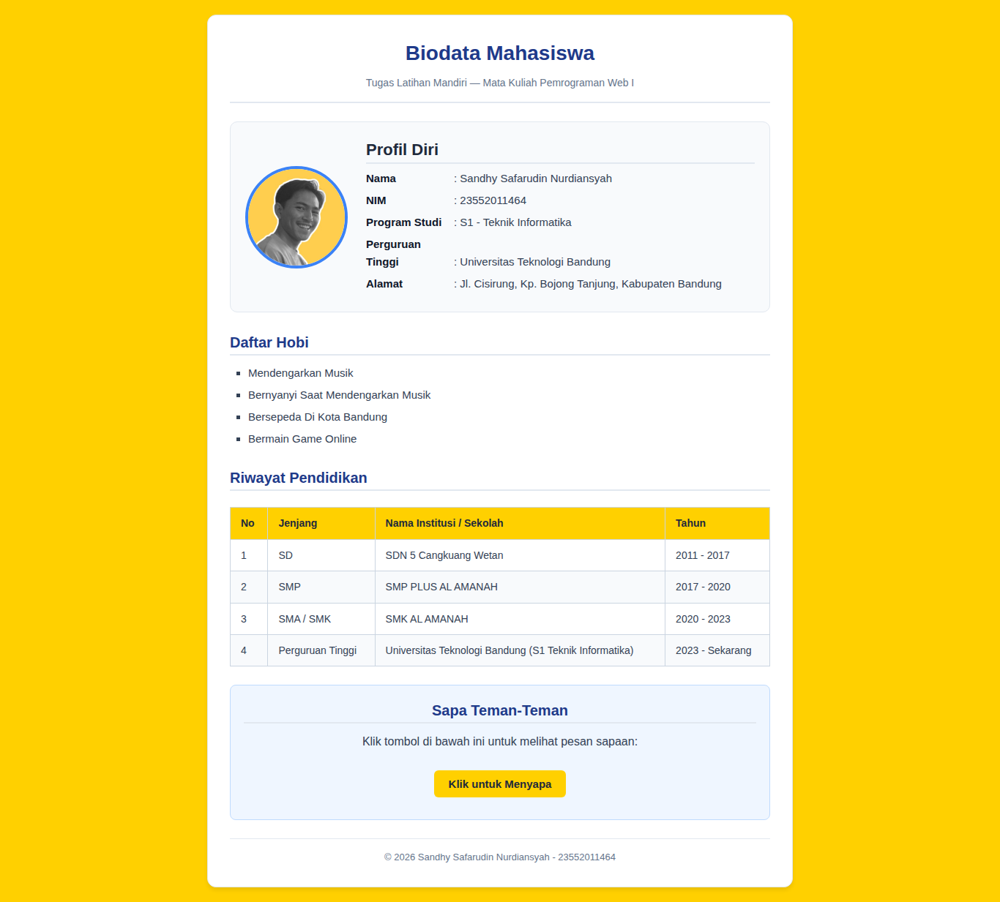
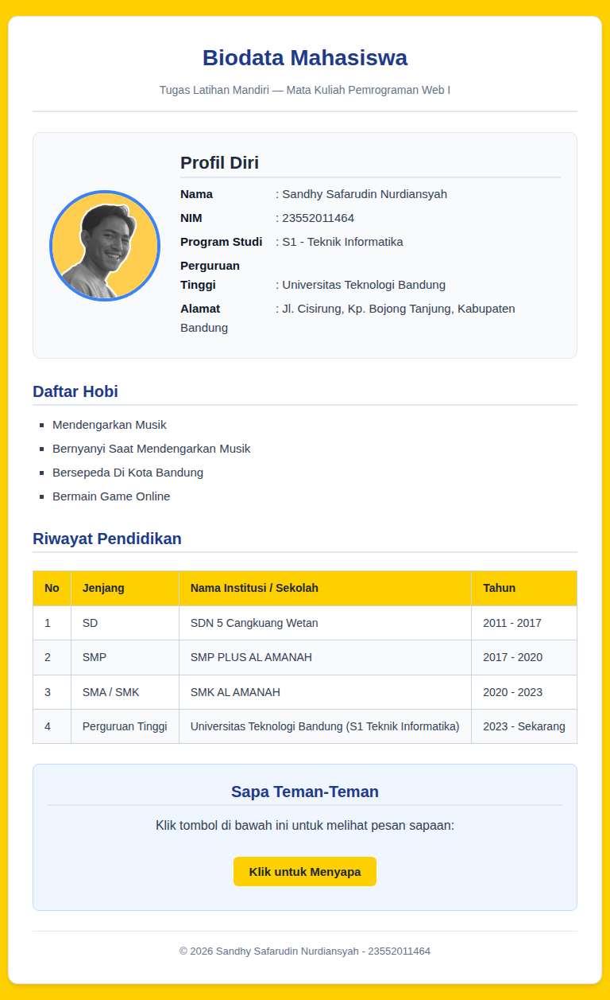

# Website Biodata Mahasiswa

Repository ini dibuat untuk memenuhi tugas **Latihan Mandiri mata kuliah Pemrograman Web I** di Universitas Teknologi Bandung.

Website ini berisi biodata mahasiswa yang dibuat menggunakan HTML, CSS, dan JavaScript dasar sesuai materi yang telah dipelajari selama perkuliahan.

## Biodata Mahasiswa

| Keterangan    | Detail                        |
| ------------- | ----------------------------- |
| Nama          | Sandhy Safarudin Nurdiansyah  |
| NIM           | 23552011464                   |
| Program Studi | S1 Teknik Informatika         |
| Universitas   | Universitas Teknologi Bandung |
| Mata Kuliah   | Pemrograman Web I             |

## Website Apa Ini?

Website ini dibuat untuk menerapkan dasar-dasar pengembangan web yang telah dipelajari. Informasi yang ditampilkan meliputi biodata pribadi, foto, hobi, dan riwayat pendidikan.

Selain menampilkan informasi, website ini juga dilengkapi dengan tombol interaktif menggunakan JavaScript serta desain responsif agar tampilannya tetap nyaman digunakan melalui komputer maupun ponsel.

## Fitur Website

- Menampilkan biodata mahasiswa.
- Menampilkan foto dan daftar hobi.
- Menampilkan riwayat pendidikan dalam bentuk tabel.
- Menggunakan CSS untuk mengatur tampilan halaman.
- Menyediakan tombol interaktif yang menampilkan pesan.
- Menggunakan media query agar tampilan menyesuaikan ukuran layar.

## Yang Digunakan

- **HTML5** untuk menyusun struktur halaman.
- **CSS3** untuk mengatur tampilan dan tata letak.
- **JavaScript** untuk menambahkan interaksi sederhana.

Website ini dibuat tanpa framework atau library tambahan agar tetap sesuai dengan materi dasar Pemrograman Web I.

## Struktur Folder

```text
.
├── index.html
├── css/
│   └── style.css
├── js/
│   └── script.js
└── images/
    └── (foto dan aset gambar)
```

## Preview Website

Berikut tampilan website pada beberapa ukuran layar:

### Desktop



### Tablet



### HP


